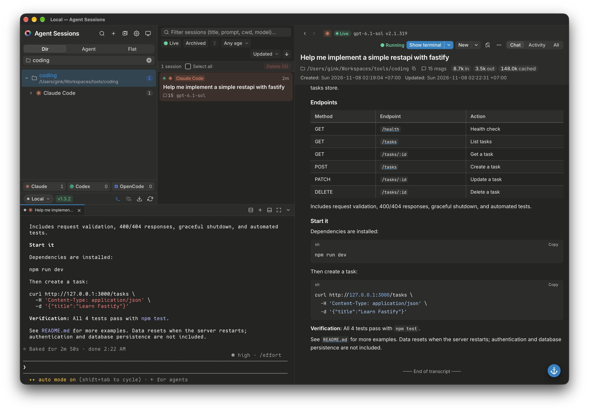

<p align="center">
  
</p>

<h1 align="center">Agent Sessions</h1>

<p align="center">
  <strong>One desktop workspace for your coding-agent sessions.</strong><br>
  Find conversations, follow the work, and pick up where you left off.<br>
  Claude Code · Codex CLI · OpenCode
</p>

<p align="center">
  <a href="https://github.com/ginkcodex/agent-sessions/releases/latest"></a>
  
</p>

<p align="center">
  <a href="https://agent-sessions.ginklab.cv">Website</a> ·
  <a href="https://agent-sessions.ginklab.cv/guides/">User guides</a> ·
  <a href="#install">Install</a> ·
  <a href="#what-you-can-do">Features</a> ·
  <a href="#get-started">Get started</a> ·
  <a href="#how-a-handoff-works">Handoff</a> ·
  <a href="#remote-hosts-and-wsl">SSH &amp; WSL</a> ·
  <a href="#build-from-source">Build from source</a>
</p>

<p align="center">
  
</p>

---

**Agent Sessions is a local-first desktop app for browsing and working with the
sessions your coding agents already save.** It reads their native histories into
one searchable interface, displays rich transcripts, and lets you resume work in
the original agent or hand context to a different one.

It also brings the surrounding workflow into the same window: an interactive
terminal, project files, a lightweight editor, and Git tools—on your computer,
in a Windows WSL distribution, or on an SSH host.

**No Agent Sessions account or central server is required.** Browsing does not
modify your agents' session histories. Editing, running commands, importing,
renaming, and deleting are explicit actions. This app is a companion to your
coding agents, not a replacement model service or a subscription to them.

## Install

Download an installer from **[the latest GitHub release](https://github.com/ginkcodex/agent-sessions/releases/latest)**.
Expand **Assets** on the release page if the downloads are hidden.

| Platform | Architecture | Download |
| --- | --- | --- |
| **Windows** | x64 / amd64 | `agent-sessions_<version>_windows_amd64_setup.exe` |
| **macOS** | Apple silicon + Intel | `agent-sessions_<version>_macos_universal.dmg` |
| **Debian / Ubuntu** | amd64 or arm64 | `agent-sessions_<version>_<arch>.deb` |
| **Fedora / RPM-based Linux** | x86_64 or aarch64 | `agent-sessions-<version>-1.<arch>.rpm` |
| **Arch Linux** | x86_64 or aarch64 | [`agent-sessions-bin`](https://aur.archlinux.org/packages/agent-sessions-bin) on the AUR |

On Linux, `uname -m` reports `x86_64` for amd64 or `aarch64` for arm64.
Choose the matching package. Native Windows ARM64 installers are not currently
published.

### Windows

1. Download the **`_setup.exe`** installer. Use it for both new installations
   and updates.
2. Close Agent Sessions and any processes using its installed files.
3. Run setup **as your normal Windows user**, not as administrator, and follow
   the wizard.
4. Open **Agent Sessions** from the Start menu.

The app installs for the current user in
`%LOCALAPPDATA%\Programs\Agent Sessions`, without an admin prompt. It requires
[Microsoft Edge WebView2 Runtime](https://developer.microsoft.com/en-us/microsoft-edge/webview2/),
which Windows 11 includes.

The installer is **not code-signed**. If SmartScreen shows “Windows protected
your PC,” choose **More info → Run anyway** only after verifying that you trust
the download.

> **Updating:** setup removes the old installation before installing the new
> one. If the new installation fails, the old version is not automatically
> restored. Setup retains its MSI and logs under
> `%LOCALAPPDATA%\ginkcode\Agent Sessions\Setup` for recovery. A standalone
> `.msi` is also available. See [Windows setup and recovery](packaging/windows/README.md).

### macOS

1. Download and open the **universal `.dmg`**.
2. Drag **Agent Sessions** into **Applications**.
3. Open it from Applications.

The same download supports **Apple silicon and Intel Macs**. The app is signed
with a Developer ID and notarized by Apple, so macOS opens it without
Gatekeeper warnings.

### Linux

Download the package for your distribution and architecture, then run the
appropriate command from the directory containing it. Replace the example
filename with the file you downloaded.

**Debian / Ubuntu**

```sh
sudo apt install ./agent-sessions_<version>_amd64.deb
```

**Fedora**

```sh
sudo dnf install ./agent-sessions-<version>-1.x86_64.rpm
```

**Arch Linux**

Install [`agent-sessions-bin`](https://aur.archlinux.org/packages/agent-sessions-bin)
from the AUR with an AUR helper. It repackages the release's `.deb`, and each
stable release updates it:

```sh
paru -S agent-sessions-bin    # or: yay -S agent-sessions-bin
```

The packages declare their **GTK 4** and **WebKitGTK 6.0** runtime dependencies;
your package manager installs them from your distribution's repositories.
This requires **Ubuntu 24.04, Debian 13, Fedora 40** or a newer distribution
that ships these libraries; Ubuntu 22.04 and Debian 12 are no longer supported.
Linux release builds use Ubuntu 24.04 as their build baseline.

Launch **Agent Sessions** from your applications menu, or run:

```sh
agent-sessions
```

### Verify a download

Each release includes `SHA256SUMS`. Download it alongside your installer and
compare the installer's checksum with its entry in that file:

```sh
# Linux
sha256sum <downloaded-file>

# macOS
shasum -a 256 <downloaded-file>
```

```powershell
# Windows PowerShell
Get-FileHash .\<downloaded-file> -Algorithm SHA256
```

Desktop packages include the headless servers used for SSH and WSL connections;
you do not need to install the desktop app on each remote host.

## Get started

1. **Run a supported coding agent at least once.** Agent Sessions discovers
   existing histories from Claude Code, Codex CLI, and OpenCode. No import is
   needed for sessions in their normal data directories.
2. **Open Agent Sessions and choose a host.** Use your local computer, select
   a WSL distribution on Windows, or connect to an SSH host.
3. **Find your work.** Browse by project or agent, filter the list, or press
   `/` to search transcript text.
4. **Read or continue.** Open a transcript, resume it in the built-in terminal,
   or create a handoff for another agent. You can also open a workspace and
   start a fresh session.

Resuming or starting an agent requires that agent to be installed and configured
on the selected host. Agent Sessions does not supply agent accounts, API credits,
or subscriptions.

## What you can do

### Find and understand past work

- **One session catalog** for Claude Code, Codex CLI, and OpenCode histories
  (including OpenCode CLI and Desktop).
- Group by directory, by agent, or use a flat list; filter by agent, directory,
  and time.
- **Full-text transcript search** with jumps to matching messages.
- Cached indexing and file watchers keep the list up to date as agents work.
- Read Markdown, tool calls and results, patches, reasoning, compactions, and
  linked subagent transcripts.
- Switch between **Chat**, **Activity**, and **All** detail levels. Inspect
  working directories, Git branches, timestamps, and available token/cost data.

### Continue in the right agent

- Resume a session using its agent's native command, copy that command, or
  launch it in a supported external terminal on local/WSL hosts.
- Run agents and shells in the **built-in tabbed terminal**, locally or over
  SSH/WSL. Maximize the panel without losing tabs or scrollback.
- Start fresh sessions in an existing project or an explicitly opened workspace.
- **Continue in another agent** with a generated handoff document: choose a
  context budget, include reasoning if needed, and optionally redact secrets.
  This passes context to the new agent; it does not convert one agent's native
  session format into another's. See [How a handoff works](#how-a-handoff-works).
- Rename sessions in the supported agents' native stores.

### Work with project files and Git

- Open project files from **Go to File**, transcript links, or terminal paths.
  Links such as `src/main.ts:42` can reveal the referenced line.
- Browse local and remote trees; create, upload, rename, or delete files and
  folders. Search and replace project text.
- Make focused edits with explicit save, unsaved-draft indicators, and
  on-disk conflict checks.
- Review Git diffs and history; stage/unstage, discard changes, commit/amend,
  and create or switch branches. Fetch, fast-forward pull, and non-force push
  are available in the project UI.
- Enable project-approved code checks and language-tool features such as
  diagnostics, hover, and definition/reference navigation for Go,
  TypeScript/JavaScript, Svelte, Python and Rust, and for Ruby RuboCop lint
  with ruby-lsp navigation.
  Support depends on the language, platform, and available tools; this is a
  lightweight workbench, not a full IDE.

> **Editing limits:** binary, non-UTF-8, mixed-line-ending, symlinked, protected,
> and larger-than-500-KB files stay read-only. Drafts live in memory, not in a
> recovery file; a crash or forced quit loses them. Saves write in place and
> are not crash-atomic. File deletion is permanent, not a move to Trash.

### Share, restore, and manage sessions

- Export **`.agent-session.zip`** bundles. **Complete** bundles retain native
  files; **share-safe** bundles omit native files and redact recognized secrets
  and home paths.
- Open a bundle to read it or prepare a handoff. Complete bundles can also be
  restored into supported agents' stores with a preview of affected files.
- Enable session deletion separately in Settings. A preview shows the files
  involved, and live sessions cannot be deleted.
- Claude Code session deletion uses Trash on Linux/macOS or Recycle Bin on
  Windows. Codex and OpenCode deletion is permanent through their CLIs and
  requires an additional opt-in.

**Redaction is best-effort, not a guarantee.** Always review a bundle or handoff
before sharing it.

### Make it comfortable

- Light, dark, and system themes; local or UTC timestamps.
- Optional message or selected-text translation through an OpenAI-compatible
  endpoint you configure. Selected-text translation includes the surrounding
  sentence as context.
- `Ctrl+,` (`⌘,` on macOS) opens Settings; `/` opens transcript search;
  `Esc` closes dialogs.

## How a handoff works

Claude Code, Codex CLI, and OpenCode store sessions in different formats, and
none of them can open another's. **Continue in** does not convert a session.
It writes a Markdown handoff document and starts a **new** session in the
target agent with it as context. The original session is left untouched, and
you can still resume it in its own agent.

**What carries over**

| Part | In the handoff |
| --- | --- |
| Instructions | Tells the agent it is continuing earlier work, to check `git status`/`git diff` first, not to redo completed work, and to summarize and wait for you before changing anything. Includes a mapping between the two agents' tool names. |
| Session facts | Source agent, session ID, original and current directory, Git branch, model, dates, and the original resume command. |
| Your messages | The first goal and **every user message, verbatim**. |
| Compaction summary | The latest one the source agent wrote, if any. |
| Working state | Files created, edited, or deleted; commands run, with failures; the latest todo list; approved plans; subagent tasks and results; errors. |
| Timeline | Earlier assistant replies and tool calls (short excerpts of tool output); reasoning only if you choose to include it. |
| Last turns | The last three messages in full, with complete tool output. |

Subagent transcripts linked to the session are included as well.

**What does not carry over:** the agent's internal state, such as its native
session ID, cached context, or permission approvals. The new agent works on the
files as they are on disk now, not as they were when the session ended.

**Budget.** Choose Compact (≈25k tokens), Detailed (≈80k, the default), Full
(≈150k), or Unlimited. When the document is over budget, the timeline is
reduced first: older tool output is dropped, then older reasoning, then older
replies are shortened to their first paragraph, and finally the timeline is
dropped. Your messages, working state, and last turns are kept. The preview
lists everything that was removed.

**Files.** Two files are written to the `handoffs` folder in the app's data
directory, on the host where the session lives: `<id>-handoff.md` (the
budgeted prompt) and `<id>-full.md` (the complete, untrimmed history, which the
agent can read when it needs more). The target agent is started in the
session's project directory with a short instruction to read the prompt file.
Both files are owner-only and deleted after 30 days. Settings can clear them
sooner. With **Redact secrets** on, recognized secrets are masked in both
files. Redaction is best-effort, so review the preview first.

## Remote hosts and WSL

**SSH:** select an alias from `~/.ssh/config` or enter a host. The app uses your
system `ssh`, deploys a bundled headless server, verifies its archive against
`SHA256SUMS`, and communicates over the SSH session. Remote hosts can run
**Linux or macOS, on amd64 or arm64**. No public application server or inbound
application port is required on the remote host.

**WSL:** on Windows, distributions appear as separate hosts and are accessed
through `wsl.exe`; SSH setup is not required.

- Browse sessions, use the terminal, and work with project files on the
  selected host.
- Configure environment overrides per host for nonstandard agent data roots.
- On Linux/macOS, SSH password and passphrase prompts appear in the app.
  On Windows, SSH must authenticate without prompts, using keys or an agent.
- Save and start/stop **SSH local port forwards** to reach remote development
  services through `127.0.0.1`. This feature is for SSH hosts, not WSL targets.

**Agents run where the session lives.** Resume and Continue in start the
agent on the selected host, in the session's project directory, using that
host's agent installation and login. For an SSH host they open in the built-in
terminal panel, or you can copy the command and run it in your own `ssh`
shell. For a WSL distribution they can also open in an external Windows
terminal. Handoff files are written on that host too, so nothing is copied
back to your computer.

Remote access is not automatic synchronization: histories remain on their
original hosts unless you explicitly export or restore them.

## Privacy and data

Session browsing runs locally against files on the selected host. There is
**no telemetry** and no Agent Sessions cloud account. Agent authentication
files such as `.credentials.json`, `auth.json`, and OpenCode account tables
are not read for session discovery.

Network activity can include SSH connections and Git operations you request,
optional translation, and language-tool/dependency downloads for enabled code
features. Agents and commands you run in terminals have their own network and
privacy behavior. A loopback listener coordinates app windows; explicitly
started SSH port forwards also listen locally.

**Translation sends the chosen message or selection and its context to your
configured endpoint.** It is not required for browsing. Code tools run with
your user permissions, **not in a sandbox**; approved checks may execute project
code, including Rust build scripts or procedural macros.

### Agent data locations

| Agent | Default location | Override |
| --- | --- | --- |
| Claude Code | `~/.claude` | `CLAUDE_CONFIG_DIR` |
| Codex CLI | `~/.codex` | `CODEX_HOME` |
| OpenCode | `~/.local/share/opencode` | `XDG_DATA_HOME` (base directory) |

### Application data locations

| Platform | Settings directory (`config.toml`) | Cache directory |
| --- | --- | --- |
| Linux | `~/.config/agent-sessions` | `~/.cache/agent-sessions` |
| macOS | `~/Library/Application Support/agent-sessions` | `~/Library/Caches/agent-sessions` |
| Windows | `%APPDATA%\agent-sessions` | `%LOCALAPPDATA%\agent-sessions\cache` |

The cache contains transcript text. Configuration can contain your translation
API key; treat both configuration and cache as sensitive. The app requests
owner-only (`0600`) file permissions where supported.

## CLI

A headless CLI is available for inspecting sessions and preparing handoffs or
bundles without the desktop UI. Linux/macOS releases publish compressed
`agent-sessions-cli-<os>-<arch>.gz` binaries, also used as remote servers.
The desktop installer does not install a standalone CLI on your `PATH`.
You can build one with `make cli`.

```sh
agent-sessions-cli scan --json
agent-sessions-cli show claude-code <session-id>
agent-sessions-cli handoff claude-code <session-id> --target codex --budget detailed --redact
agent-sessions-cli export claude-code <session-id> --profile share-safe -o session.agent-session.zip
agent-sessions-cli inspect session.agent-session.zip --json
agent-sessions-cli detect
agent-sessions-cli version
```

Agent identifiers are `claude-code`, `codex`, and `opencode`. Run
`agent-sessions-cli` without arguments to print command syntax. `serve` and
`transfer` support desktop remote operations.

## Build from source

The application uses **Go, Wails v3, and Svelte**. Use the Go version specified
in [`go.mod`](go.mod) (currently **1.26.8**) or newer, **Node.js 22** (the CI
version), npm, and Make.

```sh
git clone https://github.com/ginkcodex/agent-sessions.git
cd agent-sessions
npm ci --prefix frontend

# Headless CLI; no Wails or desktop libraries required.
make cli
./bin/agent-sessions-cli version
```

Desktop builds are plain `go build -tags desktop,production`; no Wails CLI is
needed. The packaging targets run the Wails v3 CLI for icon and Windows
resource generation through `go run`, at the version `go.mod` pins.

On **Ubuntu 24.04+ or Debian 13+**, install the desktop build dependencies
(Fedora 40+: `gcc pkg-config gtk4-devel webkitgtk6.0-devel`), then run or build:

```sh
sudo apt install build-essential pkg-config libgtk-4-dev libwebkitgtk-6.0-dev
make dev             # Desktop app on the Vite dev server, with hot reload
make app             # Desktop binary in build/bin/
```

`make dev` starts Vite on port 5173 (`DEV_PORT=...` to change it) and runs the
app without the `production` tag, pointed at Vite through
`FRONTEND_DEVSERVER_URL`. The `dev` and `app` Make targets check the Linux
GTK/WebKit dependencies. For platform-specific distributable packages, use the
targets below; macOS packaging must run on macOS with its native build tools,
while Windows packaging is cross-built on Linux.

| Target | Output / requirements |
| --- | --- |
| `make package-linux` | `.deb` and `.rpm` in `dist/`; Linux desktop build dependencies |
| `make package-macos` | Universal `.dmg` in `dist/`; macOS, Xcode command line tools, and `jq` |
| `make package-windows` | x64 setup `.exe` and `.msi` in `dist/`; Linux, `jq`, `python3`, `wixl`, and `gcc-mingw-w64-x86-64` |
| `make windows-app` | Windows `agent-sessions.exe` only, in `build/bin/`; Linux and `jq` |
| `make remote-servers` | Headless server archives in `build/remote/` |
| `make conpty` | Windows terminal runtime in `build/conpty/` |

Run `make help` for all targets. To use an installed Wails v3 CLI instead of
`go run`, pass it explicitly, for example `make package-macos WAILS3=wails3`.
See [Windows packaging notes](packaging/windows/README.md) for installer build
options and recovery details.

### Checks

```sh
make test                       # Go tests with the race detector
make lint                       # golangci-lint via go tool
make fmt                        # gofumpt + golangci-lint fmt
npm --prefix frontend test
npm --prefix frontend run check
npm --prefix frontend run build
```

## Documentation and development

- [Session formats](docs/formats.md) — on-disk formats used by the readers.
- [Product specification](SPEC.md) — design background; some original scope
  notes predate the current terminal and editing features.
- [Task breakdown](TASKS.md) and [implementation plans](docs/plan/README.md).
- [Wails v3 upgrade](docs/plan/wails-v3-upgrade.md) — current desktop build,
  supported Linux versions, and which native checks are still open.
- [Windows setup and packaging](packaging/windows/README.md).
- [Report a bug or request a feature](https://github.com/ginkcodex/agent-sessions/issues).

<details>
<summary><strong>Release workflow</strong></summary>

Pushing a `v<version>` tag runs [the release workflow](.github/workflows/release.yml):
tests, universal macOS packaging, Linux amd64/arm64 packaging, Windows amd64
packaging, and GitHub Release publication with checksums. The tag must match
`info.productVersion` in `wails.json`. Suffixed tags publish as pre-releases.

```sh
make version               # Current version and whether its tag exists
make tags                  # Release tags, newest first
make set-version V=0.2.0   # Update wails.json and commit
make release               # Tag HEAD and push the tag
make untag                 # Delete a local tag created by mistake
```

</details>

## License

Copyright © 2026 ginkcode.

Agent Sessions is **source-available** under the
[PolyForm Noncommercial License 1.0.0](LICENSE), not an OSI-approved open-source
license. The license permits noncommercial use, modification, and redistribution
under its terms, including the permitted uses it defines for noncommercial
organizations. It does not grant general commercial-use rights.

For a separate license permitting commercial use not covered by these terms,
contact **[ginkcode](mailto:ginkcode@gmail.com)**. Copyright ownership is retained
by the respective copyright holders. The software license does not grant
trademark rights in the **Agent Sessions** name or logo.

Third-party code, dependencies, and assets remain under their own licenses;
the project's license does not replace those terms. See [NOTICE](NOTICE) and
the component-specific notices. When redistributing, include the license or
its URL and preserve the required notices as specified in the license.

### File icon credits

Go to File uses [vscode-icons](https://github.com/vscode-icons/vscode-icons)
v13.0.0, copyright the vscode-icons contributors. Icons are copied unchanged
under [CC BY-SA 4.0](https://creativecommons.org/licenses/by-sa/4.0/); branded
icons remain subject to their owners' licences. See the
[local license](frontend/public/file-icons/LICENSE.md).
To regenerate the icons and filename mappings, run
`node scripts/file-icons.mjs` from `frontend/` (requires `unzip` and network access).
