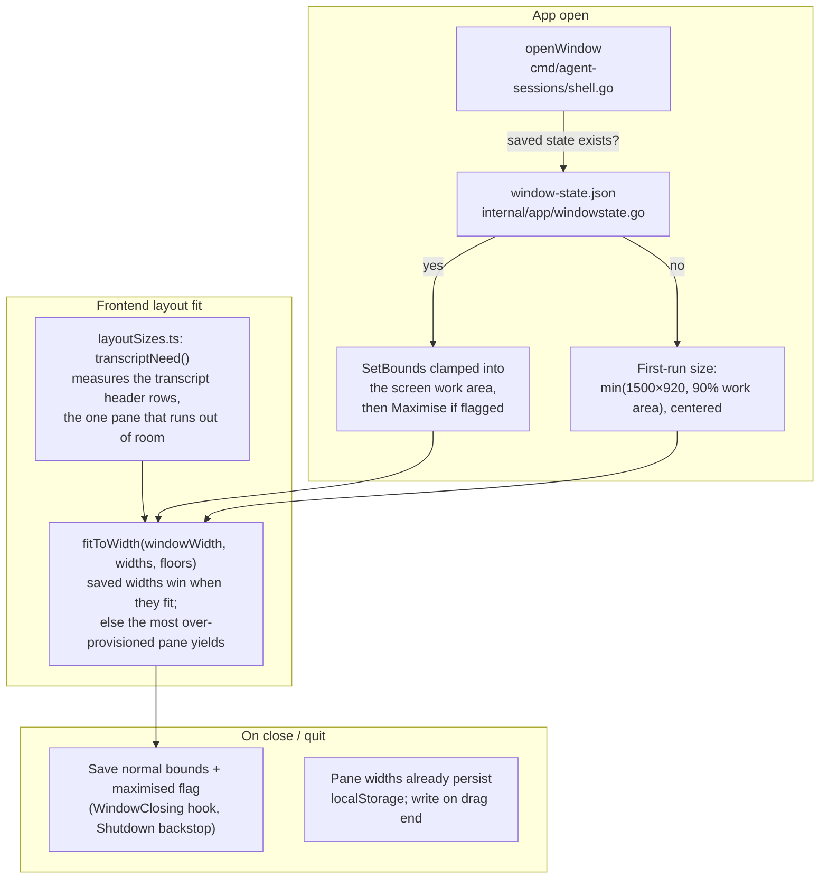

# Layout memory and content-fit sizing

## Goal

Open the app at a window and pane layout that fits its content: every pane gets
enough width to display what it holds, nothing gets more than it needs, and the
size the user settled on — window and panes — is what comes back on the next
launch. Today the window always opens at 1280×820 (`cmd/agent-sessions/shell.go`)
and the panes start at fixed 260/340 px defaults regardless of window width or
content (`frontend/src/lib/stores/preferences.svelte.ts` `LIMITS`), so a wide
window wastes the screen while a narrow one crams the transcript.

## Design

- **Content needs** (`frontend/src/lib/layoutSizes.ts`, pure and unit-tested):
  the sidebar and session list keep their proven defaults and floors — they
  fit their content at these sizes. Content measurement covers the transcript
  header, the pane that runs out of room: `transcriptNeed(rows, measure)` is
  the width its rows show unwrapped — shrinkable items (the cwd path) count
  only their minimum width, the rest their measured text — capped so one long
  path cannot take over the window. Text is measured with a canvas
  `measureText` at the header's computed fonts.
- **Layout resolution** (`fitToWidth`): remembered widths win whenever they fit
  the window — the user's layout is never fought. When the window narrows, the
  sidebar and session list give up width, the pane further above its floor
  first, so the transcript keeps `max(380 px, transcriptNeed)`. Only a window
  too small for all three floors lets the transcript take the hit.
- **No jumping**: panes never resize themselves while the user is not
  resizing; the calculation runs at open and at window resize. The existing
  equalize action (double-click/Enter on a splitter) stays as it is.
- **Window geometry memory** (Go): `internal/app/windowstate.go` keeps a small
  role-keyed store (`primary`, `extra`) in `window-state.json` through
  `internal/configfile`, written atomically. Save on `WindowClosing` (hook
  already exists in `cmd/agent-sessions/shell.go`) with `OnShutdown` as backstop:
  the normal (un-maximised) bounds plus a maximised flag — the normal bounds are
  tracked from move/resize events so a maximised close still restores the size
  the user had before maximising. Restore in `openWindow`: `SetBounds` clamped
  so the window intersects the current screen work area
  (`GetScreen`/`ScreenNearestDipRect`), then `Maximise()` when flagged.
  Fullscreen is not restored; the window comes up windowed or maximised.
- **Multi-window**: the first window of a run uses `primary`, windows opened
  with New Window use `extra` and cascade (+32 px from the opener) when no
  `extra` state is saved. Both roles save on close.
- Pane widths and the terminal panel height/position keep their existing
  `localStorage` persistence (`agent-sessions:pane-widths`,
  `agent-sessions:terminal-panel`); pane widths start writing on drag end
  instead of every animation frame.

## Decisions

- Remembered user layout beats calculated layout. Content-based sizing fills the
  gaps: first run, remembered widths that no longer fit, and window resize.
- The sidebar and session list keep fixed defaults, not measured ones. Only
  the transcript header is measured, and only the window size changes what
  users see. The defaults were 260 / 340 px, barely above the 200 / 260 px
  floors, where the column headers only just fit; they are now 280 / 380 px
  so the headers show in full (LL-05).
- Window geometry lives on the Go side (`window-state.json`), pane layout in
  `localStorage` as today. The frontend never needs new bindings, so
  `internal/app/binding_contract_test.go` is untouched.
- First-run window size is computed from the screen, not from measured content:
  the window must exist before the catalog can be measured, and resizing the
  window after it appears is visible and jumpy. 1500×920 is the smallest size
  where the three panes fit their default content widths un-truncated; smaller
  screens get 90% of the work area and the panes clamp.
- Save on close and quit only, not debounced during moves: the ask is "remember
  the size when the app closes", and it avoids write churn. A crash loses at
  most the last session's layout.
- One geometry per window role, not per window instance: window names are
  per-run, and users recognize "the window I use" vs "extra windows".

## Risks

- Monitor unplugged or DPI changed between runs: saved bounds may not fit. The
  work-area clamp moves the window fully onto the nearest screen; it must never
  open half off-screen or at negative coordinates.
- A maximised close must not save the maximised bounds as the normal size, or
  the window "grows" every run. The move/resize tracker keeps the pre-maximise
  bounds.
- Canvas measurement of content must not run per render or per session
  selection, or the layout jumps while browsing. Compute the need at open and
  at window resize only, with the hard floors as fallback while nothing is
  loaded.
- Windows snap layouts and macOS green-button fullscreen change bounds outside
  the app's control; only trust bounds read at close time.

## Release criteria

- Fresh install on a 1080p and a 1440p screen: window opens large enough that
  sidebar, session list and transcript all show their default content without
  truncation or header wrapping.
- Resize, move, maximise, close, reopen: same size, position and maximised
  state, on Windows, Linux and macOS.
- Maximise → close → reopen: window is maximised and un-maximising returns to
  the previous size, not the maximised size.
- Saved geometry with the monitor removed: window reappears fully visible on the
  remaining screen.
- Dragging a splitter still persists across restarts; shrinking the window
  never produces a pane below its floor while another has slack, and the
  transcript header stays unwrapped whenever the window can fit it.
- Unit tests cover `layoutSizes` (needs, balance, clamp, caps) and the Go
  window-state round trip including the work-area clamp and the maximised flag;
  `go test ./...` and the frontend suite pass; the binding contract test is
  green without changes.
